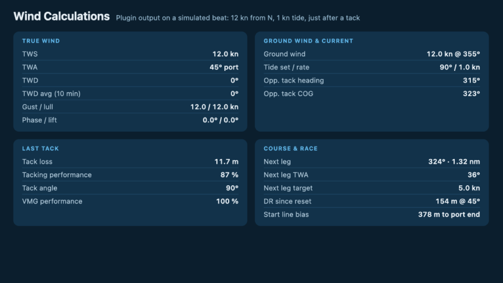

# signalk-wind-calculations

Derives true wind, ground wind, current, VMG, wind shifts, start line bias, tack loss, next leg and dead reckoning from your apparent wind sensor and the boat's own motion. Optionally corrects for heel and scales wind speed from masthead height to a 10 m reference.

It fills in the values the [B&G performance plugin](https://github.com/htool/signalk-bandg-performance-plugin) can send to Vulcan/Zeus/Triton2 displays but that nothing else in Signal K calculates. See [B&G display mapping](#bg-display-mapping).



## Install

From the Signal K App Store, search for *Wind Calculations*, or:

```bash
cd ~/.signalk && npm install signalk-wind-calculations
```

Then restart the server and enable the plugin under *Server → Plugin Config*.

## Outputs

| Path | What | Needs |
|---|---|---|
| `environment.wind.angleTrueWater` | True wind angle (TWA) | AWA, AWS, STW |
| `environment.wind.speedTrue` | True wind speed (TWS) | AWA, AWS, STW |
| `environment.wind.directionTrue` | True wind direction (TWD) | + heading |
| `environment.wind.directionMagnetic` | TWD, magnetic | + variation |
| `environment.wind.angleTrueGround` | Ground wind angle | AWA, AWS, SOG, COG, heading |
| `environment.wind.speedOverGround` | Ground wind speed | AWA, AWS, SOG, COG, heading |
| `environment.wind.directionGround`\* | Ground wind direction | AWA, AWS, SOG, COG, heading |
| `environment.current` | Current `drift`, `setTrue`, `setMagnetic` | **compass** heading, STW, SOG, COG |
| `environment.currentDrift`\* / `currentSetTrue`\* | The same drift and set as plain numbers, for consumers that can't read objects (like the B&G plugin) | as above |
| `performance.oppositeTackCourseOverGroundTrue`\* | Expected COG after tacking or gybing, including current | TWD, heading, STW |
| `performance.tackTrue` / `tackMagnetic` | Heading after tacking (off by default) | TWD, heading |
| `performance.velocityMadeGood` | VMG to wind, + upwind / − downwind | STW, TWA |
| `performance.velocityMadeGoodRatio`\* | VMG / polar target VMG | VMG + `performance.beat/gybeAngleVelocityMadeGood` |
| `environment.wind.speedTrueReferenceHeight`\* | TWS scaled to reference height | TWS, sensor height |
| `environment.wind.speedTrueAverage`\* | Average TWS over the window | TWS |
| `environment.wind.speedTrueMax`\* | Gust (max TWS) over the window | TWS |
| `environment.wind.speedTrueMin`\* | Lull (min TWS) over the window | TWS |
| `environment.wind.directionTrueAverage`\* | Circular mean TWD over the window | TWD |
| `environment.wind.phase`\* | TWD − average TWD, positive = veered | TWD |
| `performance.windLift`\* | Shift relative to the current tack, positive = lift | TWD, TWA |
| `navigation.racing.startLineBias`\* | Metres the starboard end is ahead of the port end, negative = port end favoured | TWD + start line |
| `performance.tackLoss`\* | Metres to windward lost in the last tack | STW, AWA, AWS |
| `performance.tackingPerformance`\* | Windward distance made during the last tack / reference; 1 = no loss | STW, AWA, AWS |
| `performance.tackAngle`\* | Angle tacked through (TWA before + after) | STW, AWA, AWS |
| `navigation.nextLeg.bearingTrue`\* / `distance`\* | The route leg after the current destination | active route |
| `performance.nextLegTrueWindAngle`\* | TWA the next leg would be sailed at | next leg + TWD |
| `performance.nextLegTargetSpeed`\* | Polar speed for the next leg, at beat/gybe angle if it must be tacked/gybed | next leg + TWD + polar |
| `navigation.deadReckoning.bearingTrue`\* / `bearingMagnetic`\* / `distance`\* | Distance and direction sailed through the water since reset | **compass** heading, STW |

\* Not in the Signal K spec; the plugin publishes `meta` (units, description) for these.

Heading is taken from `navigation.headingTrue`, else `headingMagnetic + magneticVariation`, else (if enabled) COG when SOG is above *min SOG*.

Variation changes very slowly, so the last `navigation.magneticVariation` is used however old it is, starting from the value the server already has. If none has been received since the server started (no GPS fix), the *fallback magnetic variation* setting is used.

Without a compass, everything that needs a heading uses COG instead, which ignores current and leeway, and current can't be calculated at all, since COG minus COG is always zero.

The start line comes from `navigation.racing.startLineStb`/`startLinePort`, or from signalk-race-control's `racecontrol.startLine`. Which end is which is worked out from the wind direction, so the order of the ends doesn't matter. The average TWD is used when available.

## Tack loss

A tack is TWA changing sign while upwind, with the boat settled beyond *min tack angle* on both sides, so luffing head to wind doesn't count. Gybes aren't counted. Over a window from *pre* seconds before the boat crosses the wind to *post* seconds after (10 + 30 s by default), the plugin compares the distance actually made to windward (∫ STW·cos TWA) with sailing at the reference VMG for the same time:

- **Tack loss** = reference VMG × window − distance made (metres)
- **Tacking performance** = distance made / (reference VMG × window)

The reference is polar-builder's target VMG (`performance.beatAngleVelocityMadeGood`) when available, else the boat's own average VMG in the 20 s before the window. Everything is measured through the water, so it works without a compass and isn't affected by current. Results are published once *post* seconds after the tack, and held until the next one.

## Next leg

The active route and the current waypoint index come from the server's course API, and the route geometry from the resources API. The next leg runs from the current destination to the waypoint after it.

Target speed needs the full polar, not just the values for the current TWA. By default it reads the live polar of [signalk-polar-builder](https://github.com/joabakk/signalk-polar-builder) straight from its data file (`plugin-config-data/polar-builder/polars.json`), using that plugin's configured percentile. It reloads whenever polar-builder saves, which is every 30 s by default. To use a fixed polar instead, set *polar file* to a TWA × TWS table in knots, such as polar-builder's `/polar/csv` export or an ORC/Expedition table.

## Dead reckoning

Integrates STW along heading (plus leeway, if enabled) since the last reset: the course and distance sailed through the water, ignoring current. Comparing it with the GPS track shows the effect of current. Without a compass heading it isn't calculated, since COG would just reproduce the GPS track.

Reset it with a PUT to `navigation.deadReckoning.reset` (for buttons in KIP and similar), with `POST /plugins/signalk-wind-calculations/deadReckoning/reset`, when signalk-race-control starts a race, or by restarting the plugin.

## Options

- **Update interval / max input age**: outputs are recalculated on a timer from the latest inputs. Any input older than *max age* counts as missing, so outputs stop instead of freezing when a sensor drops out. The plugin status shows what's missing.
- **Heel correction**: a heeled masthead sensor sees only `cos(heel)` of the cross-boat wind component. This undoes that using `navigation.attitude.roll`, clamped to *max heel*.
- **Leeway**: subtracts boat motion along the water track instead of straight ahead, and mirrors it for the opposite tack. Leeway is read from *leeway path* (positive = sliding to starboard). Set the path to `performance.leeway` to use signalk-derived-data's estimate.
- **Current damping**: current is the small difference of two noisy vectors, so it gets its own, longer time constant.
- **Damping**: exponential smoothing with the given time constant. Angles are smoothed as vectors, so they don't swing the wrong way around 0°/360° or ±180°.
- **Height correction**: power-law profile `TWS × (ref / sensorHeight)^exponent`. An exponent of ~0.11 is typical over open water.
- **Statistics window**: the period used for average, gust, lull and mean direction.

## B&G display mapping

Paths to set in the B&G performance plugin for the fields this plugin feeds. Fields whose default path already matches are marked *default*.

| B&G field | Path |
|---|---|
| Average True Wind Direction | `environment.wind.directionTrueAverage` |
| Ground Wind Direction / Speed | *default* |
| Tide Rate / Tide Set | `environment.currentDrift` / `environment.currentSetTrue` |
| Opposite Tack COG | `performance.oppositeTackCourseOverGroundTrue` |
| Heading on Opposite Tack, Opposite Tack Target heading | *default* (`performance.tackTrue`) |
| VMG Performance | *default* (`performance.velocityMadeGoodRatio`) |
| Wind Phase | `environment.wind.phase` |
| Wind Lift | `performance.windLift` |
| Bias Advantage | `navigation.racing.startLineBias` |
| Leeway Angle | `performance.leeway` (from signalk-derived-data) |
| Tacking Performance | `performance.tackingPerformance` |
| Next Leg Bearing | `navigation.nextLeg.bearingTrue` |
| Next Leg Target Speed | `performance.nextLegTargetSpeed` |
| Dead Reckoning bearing | `navigation.deadReckoning.bearingTrue` |
| Dead Reckoning Distance | `navigation.deadReckoning.distance` |

## Conflicts

`signalk-derived-data` and many instrument gateways also publish true wind and VMG. If you run one of them, turn off the matching calculation here (or set source priorities in the server), otherwise two sources will fight over the same paths.

## Development

```bash
npm test
```

The tests use the built-in `node:test` runner, which needs Node 18+. The plugin itself only uses plain CommonJS and has no dependencies.

To install into a local Signal K server for testing:

```bash
cd ~/.signalk && npm install /path/to/signalk-wind-calculations
```
